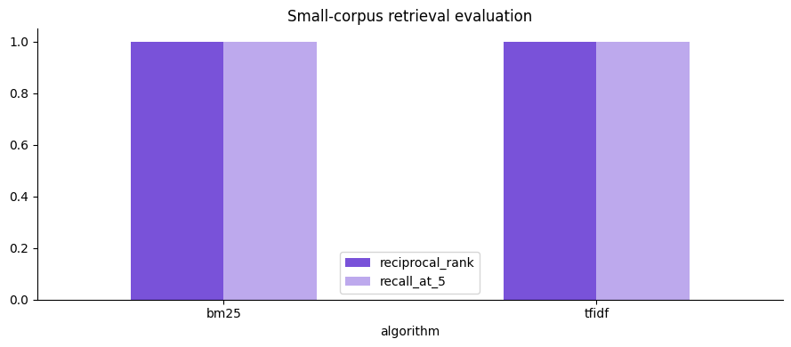
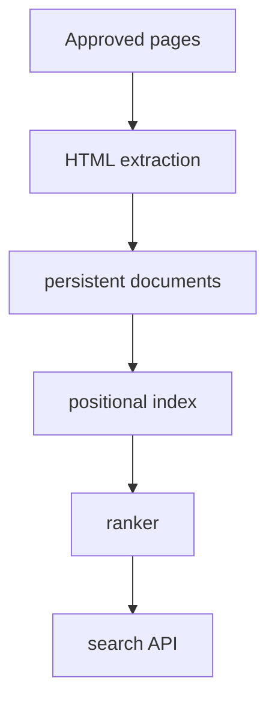

# Lumen Search

A small web search engine with a hand-built positional inverted index, BM25 and TF-IDF ranking, phrase queries, autocomplete, crawling and persistent query analytics.



**Python information retrieval · BeautifulSoup · SQLite · FastAPI**

## What it does

- BM25 and TF-IDF are implemented directly, with no hosted search service.
- Quoted phrases require adjacent token positions in exact order.
- Prefix autocomplete ranks terms by document frequency.
- SQLite persists documents, deduplicates URLs and logs query latency.
- Bounded same-host crawler respects robots.txt, applies a host allowlist and blocks private IPs.
- Notebook compares MRR, recall@5 and retrieval latency against fixed relevance judgments.

## Run locally

Requires Python 3.12+. Run each project in its own virtual environment.

```bash
git clone https://github.com/Izu-kun23/lumen-search.git
cd lumen-search
python -m venv .venv
source .venv/bin/activate
# Windows PowerShell: .venv\Scripts\Activate.ps1
python -m pip install -r requirements.txt
python -m uvicorn app.main:app --host 127.0.0.1 --port 8003
```

Open **http://localhost:8003**. Interactive OpenAPI documentation: **http://localhost:8003/docs**. No Node build, CDN, cloud database or frontend keys required. The responsive frontend uses semantic HTML, local CSS and browser JavaScript, served from the same origin as the API.

## Architecture



```text
app/
  domain/          Pure data contracts and algorithms
  services/        Application workflows and model orchestration
  infrastructure/ External providers and persistence adapters
  web/             Responsive dashboard and API client
  main.py          HTTP composition root and validation
data/              Reproducible demo corpus or local runtime storage
notebooks/         Executable analysis with saved outputs
tests/             Domain and API regression tests
```

HTTP routes validate inputs and delegate to services. Domain code contains the core rules. Infrastructure handles persistence and external providers. The same functions power notebooks and the application, preventing separate analysis and serving implementations.

## API

`GET /api/search?q=machine%20learning&algorithm=bm25`, `GET /api/suggest?q=ret`, `GET /api/stats`, `POST /api/crawl` (`{"url":"https://approved.example","max_pages":5}`).

All endpoints are documented and callable in `/docs`. Errors use standard FastAPI status codes and a `detail` payload. `GET /api/health` is available for health checks.

## Notebook and verification

```bash
python -m pip install -r requirements.lock
python -m pytest -q
# Optional DOM interaction checks (Node 24+)
npm ci
npm run test:ui
python -m pip install jupyterlab
python -m jupyter lab notebooks
```

Open the notebook and choose **Run All**. Checked-in outputs are generated from real executions on bundled data, not hand-entered results. See [verification](docs/verification.md) for measured outcomes and scope.

## Configuration and limitations

The bundled 12-article corpus is original demonstration content with illustrative example.org identifiers, not crawled external pages. Set `CRAWL_ALLOWED_HOSTS=docs.yourdomain.com` to enable an approved crawl host. Empty allowlist disables crawling. Only ports 80/443, HTML/text, no redirects, ≤1 MB per response, ≤10 pages, 10s request timeout. If robots.txt cannot be fetched, crawling fails closed.

DNS is checked before each request, but this is not a hardened public crawling service: DNS rebinding requires an egress proxy or pinned transport in production. Run locally on trusted networks. The index is in memory and rebuilt after writes; multiple workers will not synchronize it. No stemming, vector retrieval, distributed indexing or Redis is claimed. Rankings and benchmark results concern a tiny corpus only.

Local persistence lives in `data/`; runtime database/model files and secrets are excluded from git. Configuration variables are described in `.env.example`.

## Docker

```bash
docker build -t lumen-search .
docker run --rm -p 8003:8000 lumen-search
```

The container runs as a non-root user. Data is ephemeral unless a writable volume is mounted at `/app/data`. Pass explicit `-e` variables for optional providers.

## Deployment boundary

This is a functioning local portfolio application, not a multi-tenant production service. There is no authentication or per-user isolation. Keep the default localhost binding; add authentication, rate limiting, request budgets, TLS, structured observability and an egress policy before public deployment. External API usage should have spend limits. Notebook results are small-data evidence, not production benchmarks.

## Design and implementation

The UI includes responsive layouts, accessible form labels, loading/error states, empty states, keyboard-focus styles and safe rendering of source/user content. No analytics tracker or external font request is required.

## License

MIT · Izuchukwu Tony
